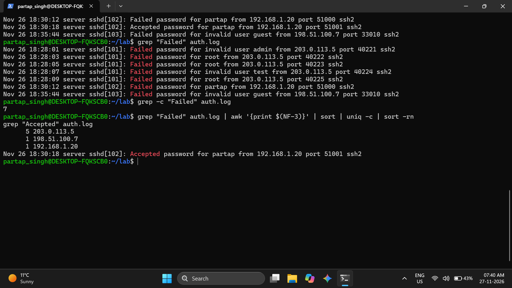

# Linux Basics: Finding Failed Logins with grep

**Concept:** Linux servers record logins in an authentication log. `grep` searches a log for a word, and `sort` and `uniq -c` count how often each value appears.

**What I did:**
- Installed Ubuntu on Windows (WSL).
- Created a sample SSH log file with example entries (not a real server log).
- Used `grep` to find failed and accepted logins, counted failures, and counted failures per IP address.

**Findings:**
- 7 failed logins and 1 accepted login.
- 5 failures came from 203.0.113.5 within 8 seconds, using the usernames admin, root and test.
- 192.168.1.20 failed once, then succeeded.

**Screenshot:**

**L1 verdict:** Five failed logins in 8 seconds from one external IP, trying common usernames, with no success, looks like a brute-force attempt. I would check the IP in AbuseIPDB and VirusTotal and escalate or block per procedure. The internal IP 192.168.1.20 failed once and then succeeded, which is most likely a typed-password mistake, so benign.
