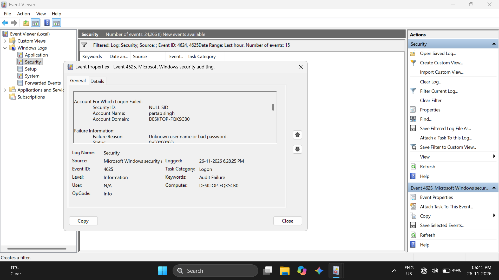
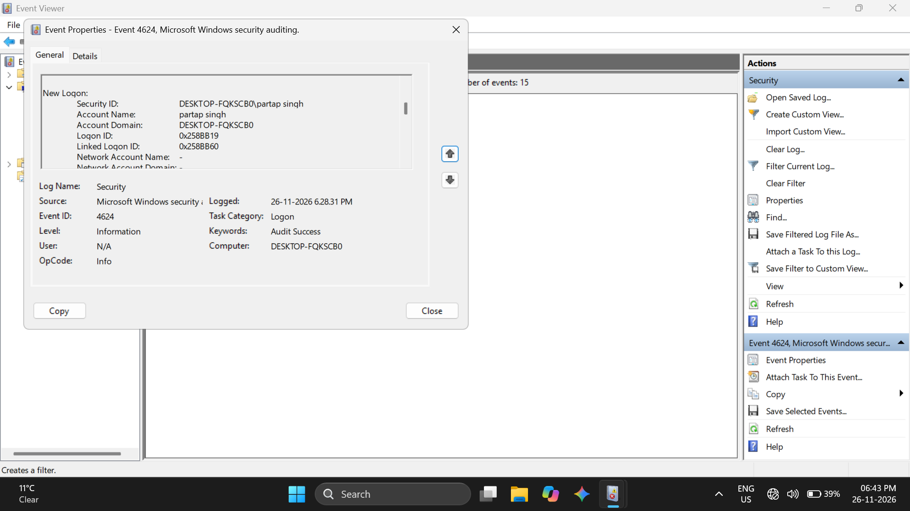

# Windows Event Viewer: Failed vs Successful Logons

**Concept:** Windows records every logon attempt in the Security log. Event ID 4625 means a failed logon. Event ID 4624 means a successful logon.

**What I did:**
- Entered a wrong password 3 times on my own laptop, then signed in correctly.
- Opened Event Viewer > Windows Logs > Security.
- Filtered the log for Event IDs 4624 and 4625.
- Opened one event of each type and read the key fields.

**Findings:**
- 4625 (failed logon): 26/11/2026, 6:28:25 PM, account for which logon failed: partap singh, reason: unknown user name or bad password.
- 4624 (successful logon): 26/11/2026, 6:28:31 PM, new logon account: partap singh, Logon Type 2 (interactive, at the keyboard).

**Screenshots:**

**L1 verdict:** A failed logon was followed by a successful logon 6 seconds later, both for my own local account at the keyboard. This is benign, no action needed. If the failures had come from an outside IP and then succeeded, I would escalate.
